# 📚 Modelagem do Sistema de Empréstimo de Livros

Modelagem orientada a objetos, em **UML**, de um sistema de biblioteca que cobre **reserva, empréstimo, renovação e devolução de livros**, além de multa por atraso com cobrança via boleto bancário.

Este repositório reúne os modelos do sistema sob cinco visões complementares: **estática** (domínio e classes), **funcional** (casos de uso), **dinâmica** (sequência, estados e atividades) e **arquitetural** (componentes e implantação). Não há código-fonte da aplicação; o foco é o modelo e a coerência entre suas partes.

---

## Sumário

- [O desafio](#o-desafio)
- [Modelos desenvolvidos](#modelos-desenvolvidos)
- [Atores e funcionalidades](#atores-e-funcionalidades)
- [Regras de negócio](#regras-de-negócio)
- [Diagramas](#diagramas)
  - [1. Casos de uso](#1-casos-de-uso)
  - [2. Domínio e classes de projeto](#2-domínio-e-classes-de-projeto)
  - [3. Sequência](#3-sequência)
  - [4. Estados do Livro](#4-estados-do-livro)
  - [5. Atividades](#5-atividades)
  - [6. Componentes](#6-componentes)
  - [7. Implantação](#7-implantação)
- [Decisões de projeto](#decisões-de-projeto)
- [Consistência entre os modelos](#consistência-entre-os-modelos)
- [Estrutura do repositório](#estrutura-do-repositório)
- [Como visualizar e editar](#como-visualizar-e-editar)
- [Autores](#autores)

---

## O desafio

A **iB2B**, uma empresa que mantém uma biblioteca, quer informatizar seu processo de empréstimo de livros e contratou uma fabricante de software para construir um sistema que permita **reservar, emprestar e devolver livros**. O sistema deve seguir o paradigma da orientação a objetos e ser documentado em UML.

### O problema

**Domínio.** Reserva, empréstimo e devolução são casos particulares de *transação*. Toda transação ocorre em uma data e envolve um **livro** e dois papéis: um **estudante** e um **atendente**, cada um assumido por uma **pessoa**. Todo papel tem um `id`; toda pessoa tem nome, sobrenome e CPF; todo livro tem título, `id` e estado.

**Quem usa o quê.** Cada ator conversa com o sistema por uma classe de entrada (tratador):

- o **Estudante** usa o `TratadorDeEmprestimo`;
- o **Atendente** usa o `TratadorDeDevolucao`;
- o **Administrador** usa o `TratadorDeAcervo`, o `TratadorDePessoa`, o `TratadorDeEstudante` e o `TratadorDeAtendente` para manter os cadastros.

**Serviços que o sistema deve oferecer:**

| Ator | Serviços |
|---|---|
| Estudante | solicitar reserva (f1), consultar reservas (f2), efetivar empréstimo (f3), renovar empréstimo (f4) |
| Atendente | registrar devolução (f5), emitir boleto de multa em caso de atraso (f6) |
| Administrador | manter Livro, Pessoa, Estudante e Atendente (inserir, consultar, atualizar, excluir) |

**Restrições de projeto:**

- Todas as transações passam por um **ponto único de acesso interno**, a `Movimentacao`. Os cadastros de pessoas, estudantes e atendentes passam pelo `Relacionamento`. Em ambos os casos, as associações internas são distintas.
- A comunicação entre os tratadores e `Relacionamento`, `Acervo` e `Movimentacao` é feita por **delegação**.
- Cada funcionalidade "manter" é definida por uma **interface** (`iLivro`, `iPessoa`, `iEstudante`, `iAtendente`), implementada pelo tratador correspondente.
- Um estudante ou atendente só pode ser cadastrado se a **pessoa** associada já estiver cadastrada.

**Dinâmica de uso.** O estudante reserva um livro e depois efetiva o empréstimo. O atendente entrega o livro, o estudante pode renová-lo e, no fim, devolve ao atendente, que registra a devolução. Se houver atraso, o atendente solicita a multa de **R$ 1,00 por dia** e o boleto é enviado ao estudante por e-mail.

**Ciclo de vida do livro.** Além de livre, reservado e emprestado, o livro pode ser **renovado**, **devolvido**, **reparando** ou **incinerado**. Após a devolução, o livro passa por uma **inspeção** antes de voltar a ficar livre: se estiver danificado, vai para reparo, e se o reparo for inviável, é incinerado.

**Organização em departamentos.** Cada informação é registrada em um departamento específico:

| Departamento | Responsável por |
|---|---|
| **Acadêmico** | estudantes |
| **RH** | pessoas e atendentes |
| **Biblioteca** | livros, reservas, empréstimos, renovações e devoluções |
| **Financeiro** | multas e boletos |
| **Banco** *(externo)* | recebimento do pagamento e informe de quitação |

O Financeiro identifica o estudante pelo CPF, emite o boleto bancário e o envia por e-mail. O estudante paga no Banco, que informa a quitação ao Financeiro, e este registra a multa como quitada.

**Infraestrutura.** O usuário acessa o sistema por um navegador, via HTTPS. A lógica de negócio roda em um servidor Ubuntu, sobre JVM e Tomcat. Os dados ficam em um **MySQL** (principal, Windows 10) com um **Oracle** (espelho, Ubuntu) em servidores distintos, ambos Dell Edge 3600.

### O que precisava ser modelado

- as classes, os atributos, os relacionamentos (generalização, associação, agregação), seus nomes, papéis e multiplicidades;
- as funcionalidades do sistema e a classe responsável por cada uma;
- os casos de uso, seus relacionamentos e os atores;
- a colaboração entre objetos em cada caso de uso;
- os estados do livro e o que provoca cada mudança;
- o fluxo de atividades entre atores e departamentos, do cadastro à quitação da multa;
- a divisão do sistema em componentes e suas interfaces;
- a implantação em nós físicos e ambientes de execução.

---

## Modelos desenvolvidos

Cada pergunta do desafio foi respondida por um modelo UML. Todos usam os mesmos nomes de classes, interfaces, operações e estados.

| Pergunta | Modelo | Seção |
|---|---|---|
| Quem usa o sistema e o que cada ator pode fazer? | **Casos de uso** | [1](#1-casos-de-uso) |
| Quais são os conceitos do problema e como se relacionam? | **Domínio** | [2](#2-domínio-e-classes-de-projeto) |
| Quais classes, atributos, operações e interfaces compõem a solução? | **Classes de projeto** | [2](#2-domínio-e-classes-de-projeto) |
| Como os objetos colaboram em cada funcionalidade? | **Sequência** (4 diagramas) | [3](#3-sequência) |
| Quais estados um livro assume e o que provoca cada mudança? | **Estados** | [4](#4-estados-do-livro) |
| Como atores e departamentos colaboram, do cadastro à quitação da multa? | **Atividades** (2 diagramas) | [5](#5-atividades) |
| Em quais componentes o sistema se divide e que interfaces cada um fornece e requer? | **Componentes** | [6](#6-componentes) |
| Onde cada parte roda e como os nós se comunicam? | **Implantação** | [7](#7-implantação) |

---

## Atores e funcionalidades

| Ator | Interage por meio de | Funcionalidades |
|---|---|---|
| **Estudante** | `TratadorDeEmprestimo` | Solicitar reserva (f1), consultar reserva (f2), efetivar empréstimo (f3), renovar empréstimo (f4) |
| **Atendente** | `TratadorDeDevolucao` | Registrar devolução (f5), emitir boleto de multa (f6), inspecionar livro, enviar/retornar de reparo |
| **Administrador** | `TratadorDeAcervo`, `TratadorDePessoa`, `TratadorDeEstudante`, `TratadorDeAtendente` | Manter (inserir, consultar, atualizar, excluir) Livro, Pessoa, Estudante e Atendente |
| **Banco** *(sistema externo)* | `iCobranca` / `iQuitacao` | Recebe a cobrança do boleto e informa a quitação ao Financeiro |

## Regras de negócio

- **Reserva:** só é aceita se o livro estiver cadastrado, o estudante estiver cadastrado e o livro estiver `LIVRE`.
- **Empréstimo:** só é efetivado se houver reserva do livro para o mesmo estudante. A reserva é removida da `Movimentacao` e o empréstimo é inserido.
- **Renovação:** no máximo **2 renovações**, cada uma estendendo o vencimento em **30 dias**. A primeira muda o estado para `RENOVADO`; a segunda mantém `RENOVADO`.
- **Devolução:** registra a devolução, remove o empréstimo da `Movimentacao` e leva o livro a `DEVOLVIDO`. Em seguida há **inspeção**: em bom estado o livro volta a `LIVRE`; danificado vai para `REPARANDO`.
- **Reparo:** ao retornar, o livro volta a `LIVRE`; se o reparo for inviável, o livro é `INCINERADO` (estado final).
- **Multa:** **R$ 1,00 por dia de atraso**, emitida como boleto bancário e enviada ao estudante por e-mail. O boleto passa de `EMITIDO` para `PAGO` quando o banco informa a quitação.
- **Cadastros:** um estudante ou atendente só pode ser cadastrado se a **pessoa** associada já estiver cadastrada.
- **Exclusões:** a integridade referencial não é tratada, por simplificação.

---

## Diagramas

Todos os diagramas foram feitos no **Astah** e exportados como imagem em [`docs/diagramas/`](docs/diagramas/). Nomes de classes, interfaces, operações e estados são os mesmos em todos eles.

### 1. Casos de uso

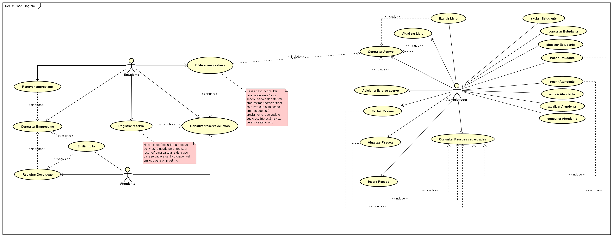

- **Estudante:** renovar empréstimo, efetivar empréstimo, registrar reserva, consultar reserva de livros e consultar empréstimo.
- **Atendente:** registrar devolução, emitir multa (`«extend»` de *Registrar Devolução*) e consultar reserva de livros.
- **Administrador:** manter livro (inserir no acervo, atualizar, excluir, consultar acervo), manter pessoa, estudante e atendente.
- Relacionamentos `«include»` reaproveitam as consultas (acervo, pessoas cadastradas, empréstimo, reserva).

### 2. Domínio e classes de projeto

**Modelo de domínio:**

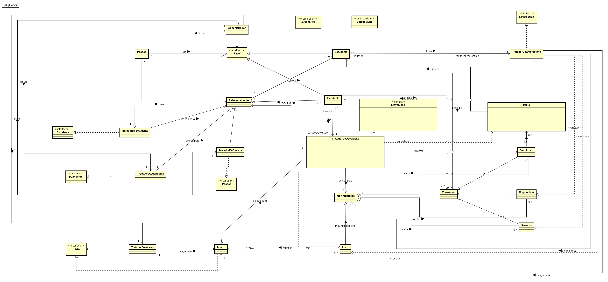

**Classes de projeto, com atributos e operações:**

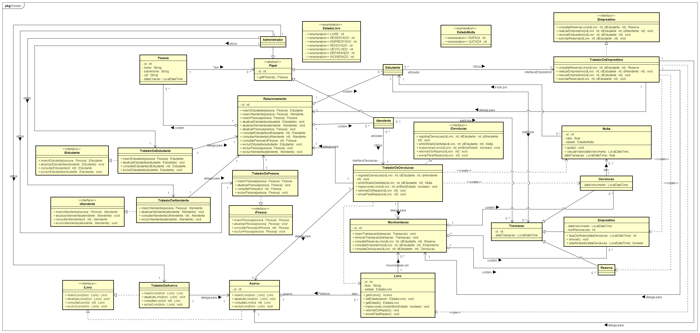

| Grupo | Elementos |
|---|---|
| **Pessoas e papéis** | `Pessoa`, `Papel` *(abstrata)*, `Estudante`, `Atendente`, `Administrador` |
| **Acervo** | `Acervo`, `Livro`, enum `EstadoLivro` |
| **Transações** | `Transacao` *(abstrata)*, `Reserva`, `Emprestimo`, `Devolucao`, `Movimentacao` |
| **Multa** | `Multa`, enum `EstadoMulta` (`EMITIDA`, `QUITADA`) |
| **Cadastros** | `Relacionamento` (ponto único de acesso a pessoas, estudantes e atendentes) |
| **Tratadores (controladores)** | `TratadorDeEmprestimo`, `TratadorDeDevolucao`, `TratadorDeAcervo`, `TratadorDePessoa`, `TratadorDeEstudante`, `TratadorDeAtendente` |
| **Interfaces** | `iLivro`, `iPessoa`, `iEstudante`, `iAtendente`, `iEmprestimo`, `iDevolucao` |

### 3. Sequência

Um diagrama de sequência por grupo de casos de uso.

**Consultar, emprestar, renovar e reservar livro.** O `TratadorDeEmprestimo` coordena `Movimentacao`, `Acervo`, `Livro` e `Relacionamento`.

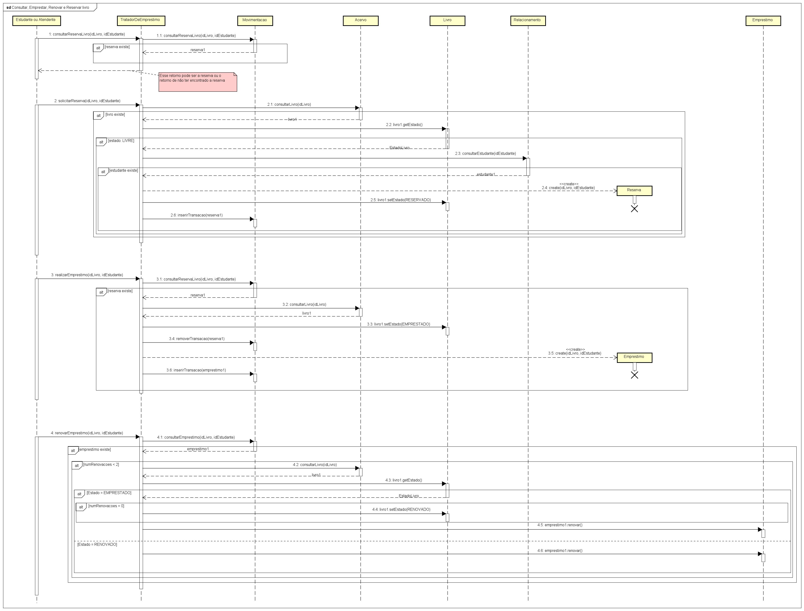

**Registrar devolução.** Cria a `Devolucao`, verifica o atraso, inspeciona o livro e remove o `Emprestimo`.

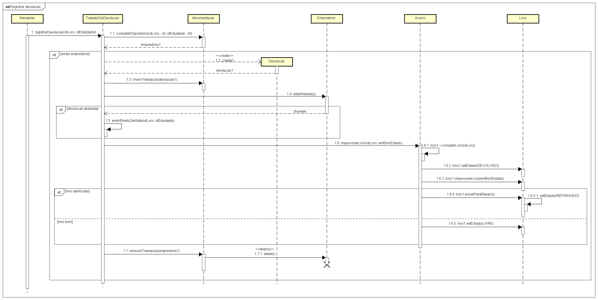

**Emitir boleto de multa.** Consulta o empréstimo, obtém os dias de atraso e cria a `Multa`.

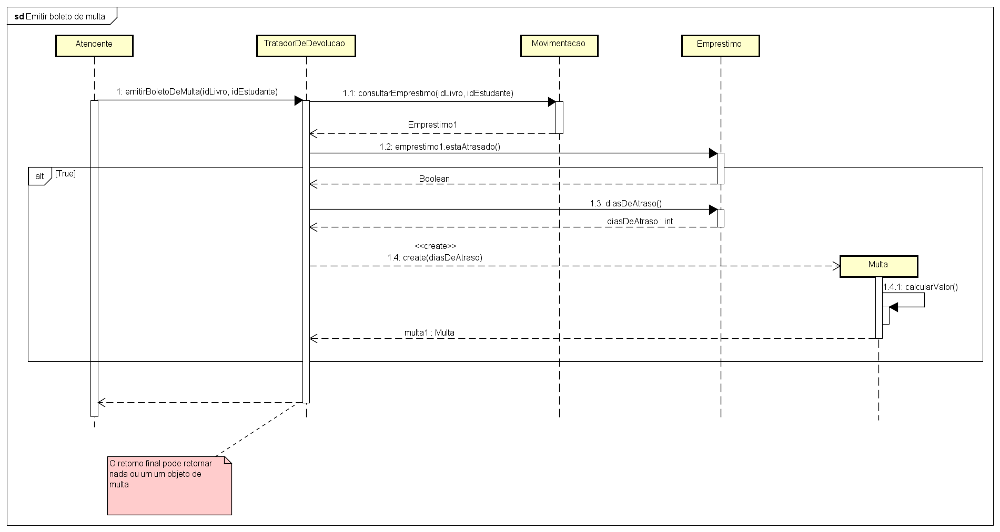

**Manter Livro, Pessoa, Estudante e Atendente.** Inserir, atualizar, consultar e excluir, conduzidos pelo Administrador.

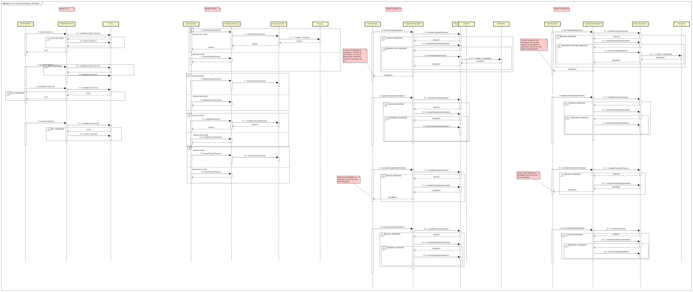

### 4. Estados do Livro

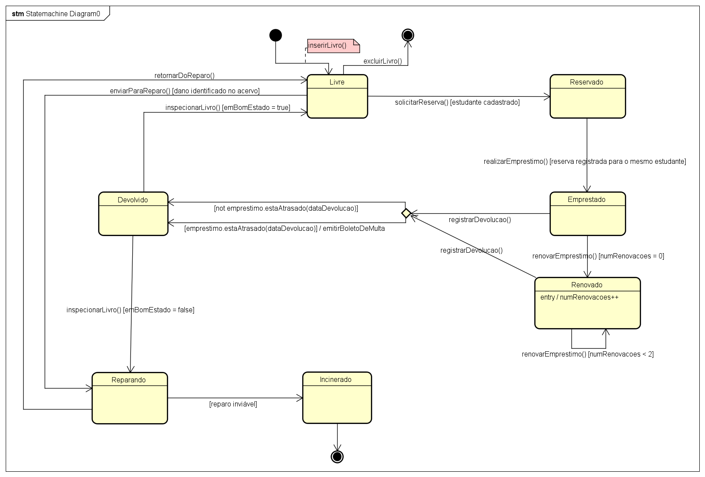

| Origem | Evento | Guarda | Destino |
|---|---|---|---|
| *(inicial)* | `inserirLivro()` | | `Livre` |
| `Livre` | `solicitarReserva()` | estudante cadastrado | `Reservado` |
| `Reservado` | `realizarEmprestimo()` | reserva registrada para o mesmo estudante | `Emprestado` |
| `Emprestado` | `renovarEmprestimo()` | `numRenovacoes = 0` | `Renovado` |
| `Renovado` | `renovarEmprestimo()` | `numRenovacoes < 2` | `Renovado` *(auto-transição)* |
| `Emprestado` / `Renovado` | `registrarDevolucao()` | | `Devolvido` (com `emitirBoletoDeMulta` se houver atraso) |
| `Devolvido` | `inspecionarLivro()` | `emBomEstado = true` | `Livre` |
| `Devolvido` | `inspecionarLivro()` | `emBomEstado = false` | `Reparando` |
| `Livre` | `enviarParaReparo()` | dano identificado no acervo | `Reparando` |
| `Reparando` | `retornarDoReparo()` | | `Livre` |
| `Reparando` | | reparo inviável | `Incinerado` *(final)* |
| `Livre` | `excluirLivro()` | | *(final)* |

O estado `Renovado` tem atividade interna `entry / numRenovacoes++`.

### 5. Atividades

Dois diagramas com partições (swimlanes) para atores e departamentos: **Acadêmico, Estudante, RH, Atendente, Biblioteca, Financeiro e Banco** (e **Administrador** no cadastro).

**Cadastros:** o administrador registra Pessoa, Estudante, Atendente e Livro. Estudante e atendente dependem da pessoa já existir no RH.

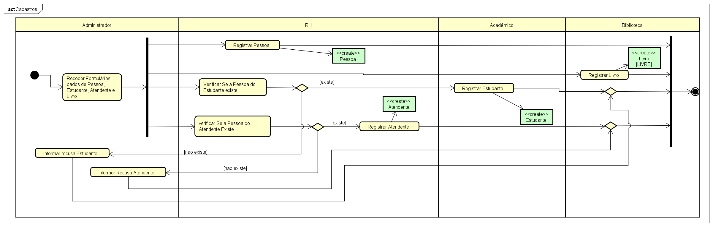

**Ciclo completo na biblioteca:** reserva → empréstimo → renovação → devolução e inspeção → reparo ou incineração → multa → pagamento no banco → quitação.

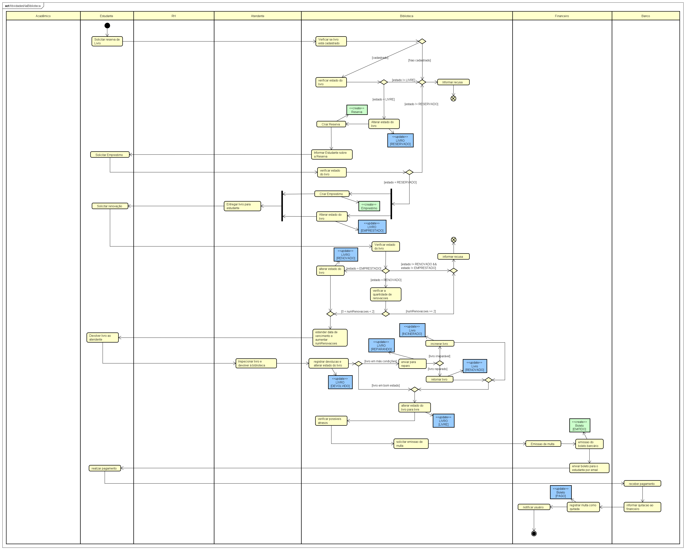

Os fluxos de objeto mostram os estados de `Livro` (`RESERVADO`, `EMPRESTADO`, `RENOVADO`, `DEVOLVIDO`, `REPARANDO`, `INCINERADO`, `LIVRE`) e de `Boleto` (`EMITIDO`, `PAGO`).

### 6. Componentes

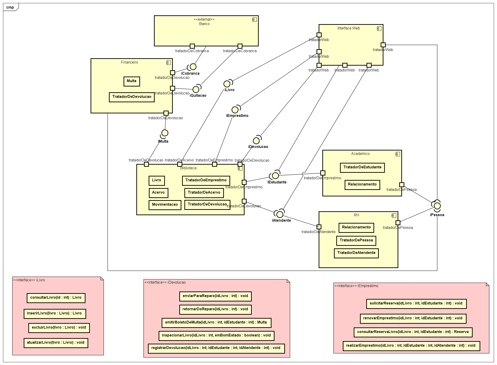

Os componentes se conectam **exclusivamente por interfaces** fornecidas (pirulito) e requeridas (soquete).

| Componente | Interfaces fornecidas | Interfaces requeridas | Classes realizadoras |
|---|---|---|---|
| **Interface Web** | — | `iLivro`, `iEmprestimo`, `iDevolucao`, `iEstudante`, `iAtendente`, `iPessoa` | — |
| **Biblioteca** | `iLivro`, `iEmprestimo`, `iDevolucao` | `iEstudante`, `iAtendente`, `iMulta` | `Livro`, `Acervo`, `Movimentacao`, `TratadorDeAcervo`, `TratadorDeEmprestimo`, `TratadorDeDevolucao` |
| **Acadêmico** | `iEstudante` | `iPessoa` | `TratadorDeEstudante`, `Relacionamento` |
| **RH** | `iPessoa`, `iAtendente` | — | `TratadorDePessoa`, `TratadorDeAtendente`, `Relacionamento` |
| **Financeiro** | `iMulta`, `iQuitacao` | `iCobranca` | `Multa`, `TratadorDeDevolucao` |
| **Banco** *(externo)* | `iCobranca` | `iQuitacao` | — |

**Principais operações das interfaces:**

- `iLivro`: `consultarLivro`, `inserirLivro`, `excluirLivro`, `atualizarLivro`
- `iEmprestimo`: `solicitarReserva`, `consultarReservaLivro`, `realizarEmprestimo`, `renovarEmprestimo`
- `iDevolucao`: `registrarDevolucao`, `inspecionarLivro`, `emitirBoletoDeMulta`, `enviarParaReparo`, `retornarDoReparo`

### 7. Implantação

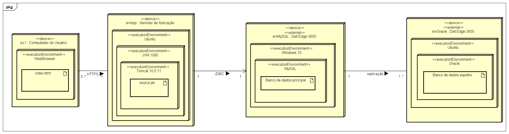

| Nó | Tipo | Ambiente de execução | Artefato |
|---|---|---|---|
| `pc1 : Computador do Usuário` | `«device»` | WebBrowser | `index.html` |
| `srvApp : Servidor de Aplicação` | `«device»` | Ubuntu ⊃ JVM 1090 ⊃ Tomcat 10.0.11 | `source.jar` |
| `srvMySQL : Dell Edge 3600` | `«device»` `«external»` | Windows 10 ⊃ MySQL | Banco de dados principal |
| `srvOracle : Dell Edge 3600` | `«device»` `«external»` | Ubuntu ⊃ Oracle | Banco de dados espelho |

**Caminhos de comunicação:** navegador → servidor de aplicação via **HTTPS** (`0..*` → `1`); aplicação → MySQL via **JDBC**; MySQL → Oracle por **replicação** (`1` → `1..*`).

---

## Decisões de projeto

- **Delegação:** os tratadores não guardam dados; delegam para `Relacionamento`, `Acervo` e `Movimentacao`.
- **Ponto único de acesso interno:** `Movimentacao` centraliza reservas, empréstimos e devoluções (associações distintas, acesso único). `Relacionamento` faz o mesmo para pessoas, estudantes e atendentes.
- **Tratadores como controladores:** cada ator conversa com uma classe de entrada, que implementa uma interface (`iLivro`, `iEmprestimo`, `iDevolucao` etc.).
- **Papéis separados de pessoas:** `Pessoa` *tem* `Papel`s (`Estudante`, `Atendente`, `Administrador`), o que permite que a mesma pessoa assuma papéis diferentes.
- **Estado do livro como enum:** `EstadoLivro` é a fonte única dos estados, usada no diagrama de classes, no de estados e nos de sequência e atividades.
- **Multa calculada na própria classe:** `Multa.calcularValor()` aplica R$ 1,00 por dia de atraso, sendo `Emprestimo.diasDeAtraso()` e `estaAtrasado()` os responsáveis por informar o atraso.

## Consistência entre os modelos

Os diagramas foram revisados para manter as seguintes correspondências:

- Os estados do `Livro` são os mesmos no atributo `estado`, no diagrama de estados e nos fluxos de objeto do diagrama de atividades.
- Os eventos do diagrama de estados correspondem a operações das classes de projeto (`Livro`, `TratadorDeEmprestimo`, `TratadorDeDevolucao`, `TratadorDeAcervo`).
- As interfaces dos componentes correspondem às interfaces e aos tratadores do diagrama de classes.
- Cada componente tem um artefato implantado em algum nó do diagrama de implantação.

## Como visualizar e editar

- **Visualizar:** abra as imagens em [`docs/diagramas/`](docs/diagramas/) ou use os links deste README.
- **Editar:** abra o arquivo `.asta` em [`modelo/`](modelo/) com o [Astah](https://astah.net/) (UML ou Professional).
- **Exportar:** no Astah, use *File → Save Diagram as Image* para atualizar as imagens após qualquer alteração.
